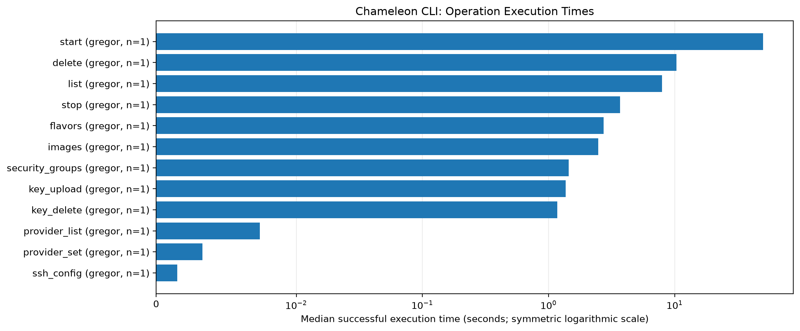
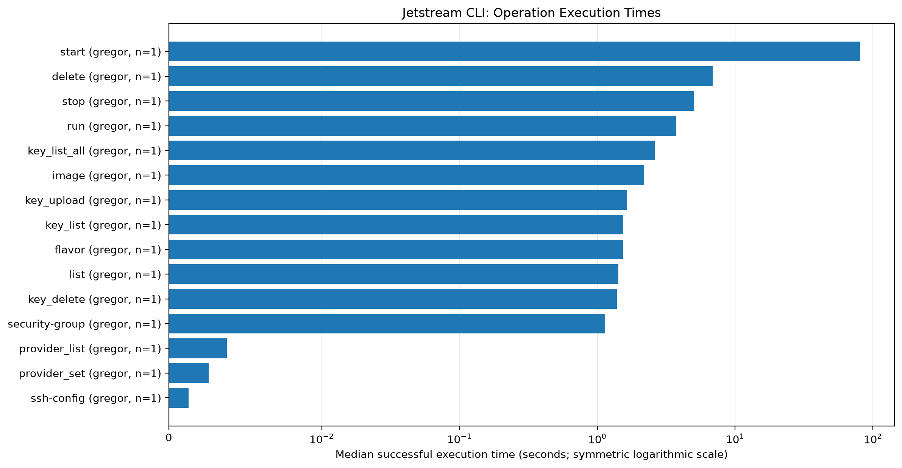
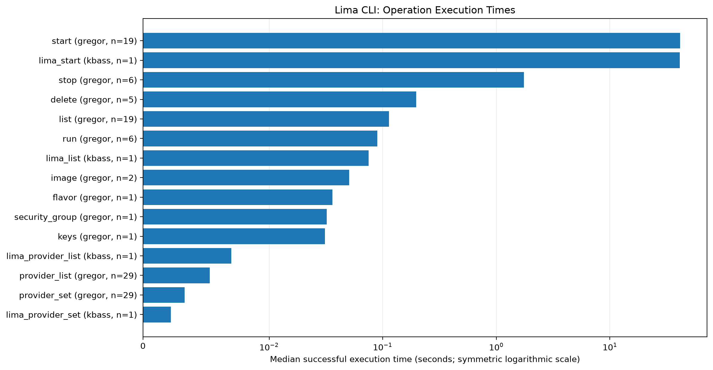
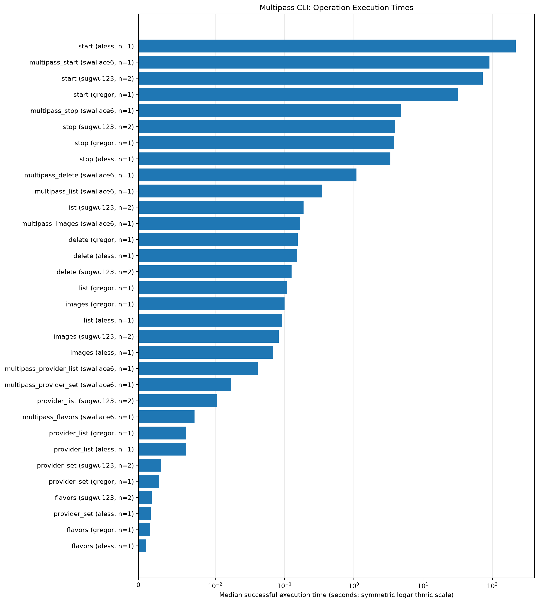
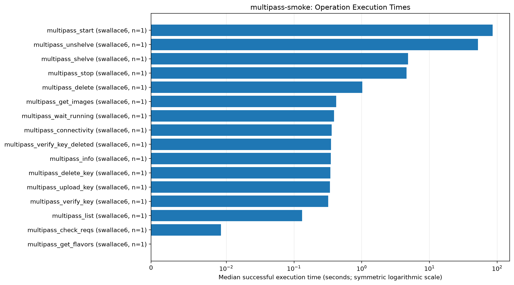

# Cloudmesh VM Smoke Test Comparison

## Overview

- Benchmark files: **38**
- Operation measurements: **224**
- Successful operations: **205**
- Non-successful operations: **19**

## Benchmark Summary

| Benchmark | Runs | Operations | Successful | Non-successful |
|---|---:|---:|---:|---:|
| Chameleon CLI | 1 | 12 | 12 | 0 |
| Jetstream CLI | 1 | 15 | 15 | 0 |
| Lima CLI | 30 | 141 | 122 | 19 |
| Multipass CLI | 5 | 40 | 40 | 0 |
| multipass-smoke | 1 | 16 | 16 | 0 |

## Contributor Coverage

| Benchmark | Contributor | Runs | Operations | Non-successful |
|---|---|---:|---:|---:|
| Chameleon CLI | gregor | 1 | 12 | 0 |
| Jetstream CLI | gregor | 1 | 15 | 0 |
| Lima CLI | gregor | 29 | 136 | 18 |
| Lima CLI | kbass | 1 | 5 | 1 |
| Multipass CLI | aless | 1 | 8 | 0 |
| Multipass CLI | gregor | 1 | 8 | 0 |
| Multipass CLI | sugwu123 | 2 | 16 | 0 |
| Multipass CLI | swallace6 | 1 | 8 | 0 |
| multipass-smoke | swallace6 | 1 | 16 | 0 |

## Execution-Time Visualizations

Charts show median durations of successful operations, grouped by benchmark, operation, and contributor.

### Chameleon Cli Execution Times



### Jetstream Cli Execution Times



### Lima Cli Execution Times



### Multipass Cli Execution Times



### Multipass Smoke Execution Times



## Non-Successful Operations

| Benchmark | Contributor | Operation | Status | Run Date |
|---|---|---|---|---|
| Lima CLI | gregor | run | failed | 2026-10-26T23:52:33.833514 |
| Lima CLI | gregor | run | failed | 2026-10-27T00:08:22.091807 |
| Lima CLI | gregor | image | failed | 2026-10-27T00:10:14.008802 |
| Lima CLI | gregor | ssh_config | failed | 2026-10-27T00:14:23.649147 |
| Lima CLI | gregor | start | failed | 2026-10-27T01:04:17.332808 |
| Lima CLI | gregor | start | failed | 2026-10-27T01:05:21.173920 |
| Lima CLI | gregor | start | failed | 2026-10-27T01:06:58.515764 |
| Lima CLI | gregor | start | failed | 2026-10-27T01:13:09.207034 |
| Lima CLI | gregor | image | failed | 2026-10-27T01:14:56.771546 |
| Lima CLI | gregor | start | failed | 2026-10-27T01:17:40.123050 |
| Lima CLI | gregor | start | failed | 2026-10-27T01:18:57.033938 |
| Lima CLI | gregor | start | failed | 2026-10-27T01:20:31.546806 |
| Lima CLI | gregor | start | failed | 2026-10-27T01:27:42.628611 |
| Lima CLI | gregor | start | failed | 2026-10-27T01:35:26.761238 |
| Lima CLI | gregor | start | failed | 2026-10-27T01:36:43.563880 |
| Lima CLI | gregor | image | failed | 2026-10-27T01:52:35.732852 |
| Lima CLI | gregor | delete | failed | 2026-10-27T01:56:24.311030 |
| Lima CLI | gregor | flavor | failed | 2026-10-27T02:05:33.594721 |
| Lima CLI | kbass | lima_run | failed | 2026-10-25T19:38:22.749893 |

## Interpretation and Limitations

- Each benchmark JSON file represents one recorded execution run.
- Operation measurements are not independent benchmark runs.
- Timing charts exclude non-successful operations, but the report retains their statuses.
- A median based on one measurement is that measurement itself; it does not establish typical performance.
- Different contributors may use different hardware, software versions, configurations, and Git commits.
- CLI benchmarks and provider smoke tests represent different workloads and should not be directly compared.
- Timing differences alone do not establish performance regressions without comparable environments and repeated runs.

## Reproduction

From the repository root, run:

```bash
python aless/smoke/analyze-smoke-tests.py
```
