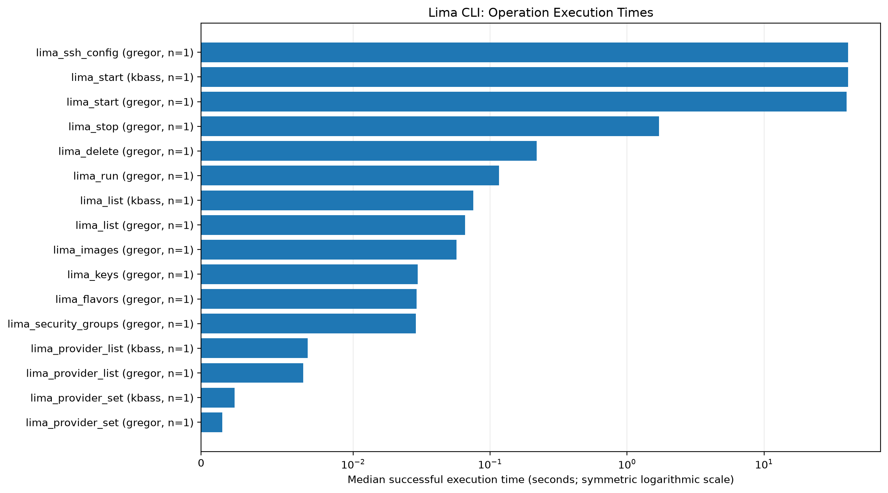
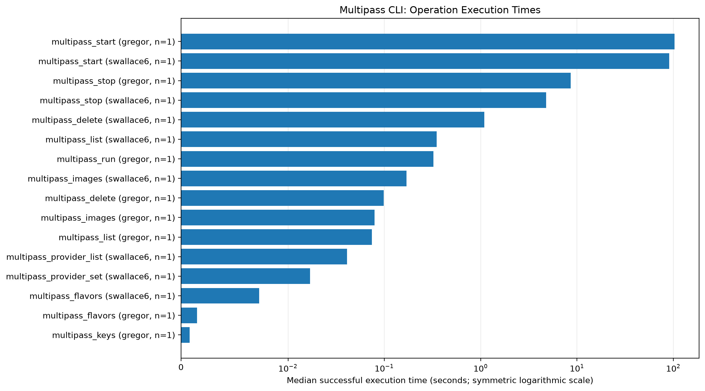
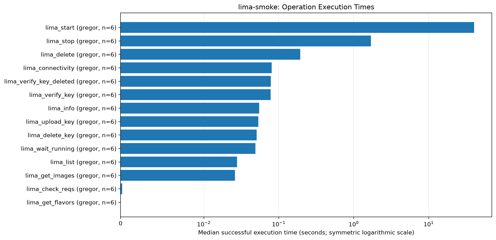
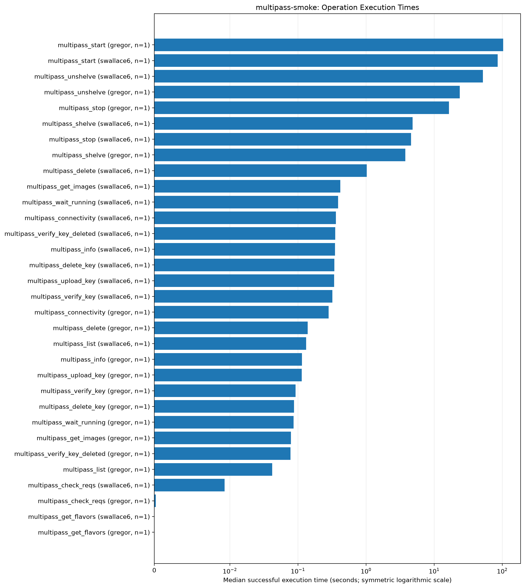

# Cloudmesh VM Smoke Test Comparison

## Overview

- Benchmark files: **12**
- Operation measurements: **149**
- Successful operations: **148**
- Non-successful operations: **1**

## Benchmark Summary

| Benchmark | Runs | Operations | Successful | Non-successful |
|---|---:|---:|---:|---:|
| Lima CLI | 2 | 17 | 16 | 1 |
| Multipass CLI | 2 | 16 | 16 | 0 |
| lima-smoke | 6 | 84 | 84 | 0 |
| multipass-smoke | 2 | 32 | 32 | 0 |

## Contributor Coverage

| Benchmark | Contributor | Runs | Operations | Non-successful |
|---|---|---:|---:|---:|
| Lima CLI | gregor | 1 | 12 | 0 |
| Lima CLI | kbass | 1 | 5 | 1 |
| Multipass CLI | gregor | 1 | 8 | 0 |
| Multipass CLI | swallace6 | 1 | 8 | 0 |
| lima-smoke | gregor | 6 | 84 | 0 |
| multipass-smoke | gregor | 1 | 16 | 0 |
| multipass-smoke | swallace6 | 1 | 16 | 0 |

## Execution-Time Visualizations

Charts show median durations of successful operations, grouped by benchmark, operation, and contributor.

### Lima Cli Execution Times



### Multipass Cli Execution Times



### Lima Smoke Execution Times



### Multipass Smoke Execution Times



## Non-Successful Operations

| Benchmark | Contributor | Operation | Status | Run Date |
|---|---|---|---|---|
| Lima CLI | kbass | lima_run | failed | 2026-10-25T19:38:22.749893 |

## Interpretation and Limitations

- Each benchmark JSON file represents one recorded execution run.
- Operation measurements are not independent benchmark runs.
- Timing charts exclude non-successful operations, but the report retains their statuses.
- A median based on one measurement is that measurement itself; it does not establish typical performance.
- Different contributors may use different hardware, software versions, configurations, and Git commits.
- CLI benchmarks and provider smoke tests represent different workloads and should not be directly compared.
- Timing differences alone do not establish performance regressions without comparable environments and repeated runs.

## Reproduction

From the repository root, run:

```bash
python kbass/smoke/analyze-smoke-tests.py
```
